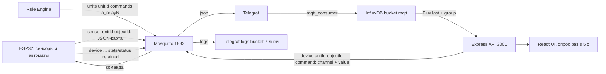

# PROJECT_CONTEXT

## Как пользоваться файлом

- В этом документе — компактная карта монорепозитория САСПИК: назначение, команды, архитектура, контракты, инварианты.
- Источники истины (при расхождении — выше побеждает): код и конфиги (`docker-compose.yml`, `platformio.ini`, `package.json`, `config.h`, `mosquitto.acl`, `telegraf.conf`) → журналы [`IN_PROGRESS.md`](saspik-cluster/IN_PROGRESS.md) подпроектов → [`AGENTS.md`](AGENTS.md) → этот документ.
- Для работы ИИ-агента основной файл — [`AGENTS.md`](AGENTS.md): правила, инварианты, типовые задачи. Здесь — обзор для человека.
- Расширенные детали (версии, полные таблицы, протоколы, история решений) — в [`DETAILS.md`](DETAILS.md); ссылки вида → DETAILS#раздел.
- Неподтверждённое помечено `UNKNOWN` или `TODO: проверить`.
- Секреты не раскрываются; упоминаются только имена переменных окружения и дефолты из конфигов репозитория.
- Содержимое сверено с кодом и журналами 2026-11-06. Обзорные разделы быстро устаревают: перед правкой сверяйтесь с кодом.

## Что это за проект

- САСПИК — программно-аппаратная платформа для совместного производства: IoT-устройства → MQTT-кластер → веб-UI ([`README.md`](README.md)).
- Системная иерархия: Кластер (автономный узел сети) → Юнит (функциональная зона: теплица, цех, склад) → Объект (физическое/виртуальное устройство: датчик, контроллер, реле).
- Монорепозиторий из 4 подпроектов:
  - [`saspik-cluster`](saspik-cluster/README.md) — микросервисное ядро на Node.js (API, UI, MQTT-брокер, rule-engine, InfluxDB/Telegraf). Работает, есть прод-пилот.
  - [`saspik-iot`](saspik-iot/README.md) — прошивки ESP32 (шлюз ESP-NOW→MQTT, сенсоры, автоматика, шаблон boilerplate).
  - [`saspik-greenhouse`](saspik-greenhouse/README.md) — пилот «автономная теплица»; сейчас это только планирование/документация.
  - [`saspik-meshrover`](saspik-meshrover/README.md) — рой автономных роботов (Pre-MVP, этап 1: UWB-дальномер).
- Потребители: оператор через веб-UI, устройства через MQTT; кластер-кластерное взаимодействие задекларировано, реализации нет → UNKNOWN.
- Границы: кластер работает автономно; иерархия и привязка объектов к юнитам настраиваются в БД/UI.

## Быстрый старт

### saspik-cluster (основной стек)

```bash
cd saspik-cluster/saspik-cluster-app
cp example.env .env            # заполнить значения
docker compose up --build -d   # поднимает 7 сервисов
```

- Сервисы, лимиты ресурсов и healthcheck'и — в [`docker-compose.yml`](saspik-cluster/saspik-cluster-app/docker-compose.yml) → DETAILS#конфигурация-docker-compose.
- Тест-стек без backend/nginx: `docker compose -f docker-compose.test.yml up` ([`docker-compose.test.yml`](saspik-cluster/saspik-cluster-app/docker-compose.test.yml)).
- Проверка: `curl http://localhost/health` (nginx → 200) и `curl http://localhost:3001/health` (backend).
- ⚠️ ACL брокера вшит в образ: после правки [`mosquitto.acl`](saspik-cluster/saspik-cluster-app/mqtt/mosquitto.acl) нужен `docker compose up -d --build mosquitto`, `restart` не обновит.

#### Локальная разработка backend

```bash
cd saspik-cluster/saspik-cluster-app/server
npm install
npm run dev            # nodemon + ts-node (читает .env при NODE_ENV != prod)
npm run build          # tsc → dist/
npm start              # node dist/index.js
npm run lint
```

- Скрипты — [`server/package.json`](saspik-cluster/saspik-cluster-app/server/package.json). Тестов нет: `npm test` завершается с ошибкой (`echo "Error: no test specified" && exit 1`).

#### Локальная разработка client

```bash
cd saspik-cluster/saspik-cluster-app/client
npm install
npm start              # CRA dev-server
npm run start:mock     # REACT_APP_MOCK_MODE=true, данные без API
npm run build          # production-сборка
npm test               # Jest (CRA)
```

#### MQTT Rule Engine

```bash
cd saspik-cluster/saspik-cluster-app/mqtt-rule-engine
npm install
npm run dev            # ts-node src/index.ts
npm run build && npm start
npm run test           # самописный раннер на мок-адаптере
npm run lint
```

- Источник правил выбирается `RULES_SOURCE=mongo|api|file` (по умолчанию `mongo`) ([`rulesProviderFactory.ts`](saspik-cluster/saspik-cluster-app/mqtt-rule-engine/src/providers/rulesProviderFactory.ts)).

### saspik-iot (прошивки)

- Требуется [PlatformIO Core ≥ 6.x](https://platformio.org) и плата ESP32/S2/S3/C3 ([`esp32-boilerplate/README.md`](saspik-iot/saspik-iot-sketches/esp32-boilerplate/README.md)).

```bash
cd saspik-iot/saspik-iot-sketches/esp32-boilerplate
pio run -e sensor_esp32      # сборка шаблона Sensor
pio run -e gateway_esp32 -t upload
pio test -e native           # host-тесты Unity (5 наборов, без железа)

cd ../esp32-local-mqtt
pio run                      # env esp32dev; pio run -t upload; pio device monitor
```

- Готовые env boilerplate: `{gateway,sensor,device}_{esp32,s2,s3,c3}` + `native` — в [`platformio.ini`](saspik-iot/saspik-iot-sketches/esp32-boilerplate/platformio.ini). Роль выбирается build-флагом `-DDEVICE_ROLE=1|2|3`.
- Действующий скетч автоматики — [`esp32-local-mqtt`](saspik-iot/saspik-iot-sketches/esp32-local-mqtt/README.md): `OBJECT_ID=saspik-awqm001`, `UNIT_ID=unitId3`, каналы «свет»/«полив» на GPIO 13/26 ([`config.h`](saspik-iot/saspik-iot-sketches/esp32-local-mqtt/src/config.h)).
- Wi-Fi-креды: `src/env_config.h` генерируется из `.env` скриптом [`extra_script.py`](saspik-iot/saspik-iot-sketches/esp32-local-mqtt/extra_script.py) и в git не входит.

### saspik-meshrover

- Проект PlatformIO с каркасом ESP-IDF: `framework = espidf` ([`platformio.ini`](saspik-meshrover/software/platformio.ini)).
- Сборка: `pio run -e esp32-s3-devkitc-1` (эквивалент — `idf.py build` при заданном `IDF_PATH`).
- Аппаратная часть и распиновка — [`docs/hardware.md`](saspik-meshrover/docs/hardware.md).

## Архитектура и структура

### Поток данных (основной контур)



### Слои saspik-cluster

- `server` — Express + InversifyJS (DI), слои: controllers → services → repositories ([`server/src/index.ts`](saspik-cluster/saspik-cluster-app/server/src/index.ts)). Обогащение объектов текущими значениями из state store живёт в контроллере (`enrichObject`), а не в сервисе.
- `client` — React 19 SPA (CRA): компоненты + хуки, API-вызовы напрямую через `fetch`, опрос списка объектов каждые 5 с ([`use-objects-list-fetching.ts`](saspik-cluster/saspik-cluster-app/client/src/hooks/use-objects-list-fetching.ts)); мок-режим — [`mock-api.ts`](saspik-cluster/saspik-cluster-app/client/src/components/mock-api.ts).
- `mqtt-rule-engine` — воркер: адаптер MQTT → движок правил (индекс по топикам) → условия/действия; правила перезагружаются в рантайме ([`engine.ts`](saspik-cluster/saspik-cluster-app/mqtt-rule-engine/src/core/engine.ts)).
- `nginx` — статика SPA + прокси `/api` → backend:3001, SPA fallback, кэш статики 1 год ([`nginx.conf`](saspik-cluster/saspik-cluster-app/nginx/nginx.conf)).

### Таблица «путь — назначение — что менять»

| Путь | Назначение | Что менять аккуратно |
| --- | --- | --- |
| [`saspik-cluster/saspik-cluster-app/server/src`](saspik-cluster/saspik-cluster-app/server/src) | REST API, DI, Mongo/Influx/MQTT | Роуты (`app.ts`), сервисы, репозитории; сборка DI в `index.ts` |
| […/server/src/data/units.config.ts](saspik-cluster/saspik-cluster-app/server/src/data/units.config.ts) + `unitId1.config.ts` / `unitId2.config.ts` | Сиды юнитов/объектов (только `unitId1`, `unitId2`) | Только при сознательной миграции Mongo (сид не перезаписывает непустые коллекции) |
| […/server/data/rules.json](saspik-cluster/saspik-cluster-app/server/data/rules.json) | Сид климат-правил (env-подстановка `${VAR}`/`${expr:...}`) | Правила дублируются на unitId; движок не подставляет unitId из wildcard-топика |
| […/mqtt-rule-engine/src](saspik-cluster/saspik-cluster-app/mqtt-rule-engine/src) | Движок правил | Новые условия/действия: класс + `constants.ts` + `config/builder.ts` |
| […/telegraf/telegraf.conf](saspik-cluster/saspik-cluster-app/telegraf/telegraf.conf) | MQTT → InfluxDB | `[agent] hostname` и подписки — ломают серии/данные при небрежной правке |
| […/mqtt/mosquitto.conf](saspik-cluster/saspik-cluster-app/mqtt/mosquitto.conf), `mosquitto.acl` | Брокер, ACL | Default-deny: новый домен без правила ACL молча отбрасывается; ACL в образе |
| […/influxdb/provision](saspik-cluster/saspik-cluster-app/influxdb/provision) | Создание бакетов при старте | Провижининг нефатален, но без него нет бакета `logs` |
| […/client/src](saspik-cluster/saspik-cluster-app/client/src) | UI | Роуты, формы, хуки; мок-режим через `REACT_APP_MOCK_MODE` |
| [`saspik-iot/saspik-iot-sketches/esp32-boilerplate`](saspik-iot/saspik-iot-sketches/esp32-boilerplate) | Библиотека `saspik-core` + три шаблона ролей | Всё compile-time в `include/config.h`; host-тесты `pio test -e native` |
| [`saspik-iot/saspik-iot-sketches/esp32-local-mqtt`](saspik-iot/saspik-iot-sketches/esp32-local-mqtt) | Действующее устройство автоматики (`saspik-awqm001`) | `config.h`: `CHANNELS[]`, топики, таймауты ребута |
| [`saspik-iot/saspik-iot-sketches/shared`](saspik-iot/saspik-iot-sketches/shared) | Общие библиотеки `wifi-config`, `device-log` | Captive portal и NVS-лог причины ребута |
| [`saspik-meshrover/software`](saspik-meshrover/software) | UWB-прошивка (PlatformIO + ESP-IDF) | Параметры UWB в `include/config.h`, `lib/dwm3000` |

### Ключевые модули и точки входа

- Backend: [`server/src/index.ts`](saspik-cluster/saspik-cluster-app/server/src/index.ts) (bootstrap + DI) → [`server/src/app.ts`](saspik-cluster/saspik-cluster-app/server/src/app.ts) (роуты, seed, послестартовые хуки).
- Client: [`client/src/index.tsx`](saspik-cluster/saspik-cluster-app/client/src/index.tsx) → [`pages-routes.tsx`](saspik-cluster/saspik-cluster-app/client/src/components/pages-routes/pages-routes.tsx): `/`, `/monitoring`, `/automation`, `/rules`, `/info`, `/unit/:unitId/*`, `/unit/:unitId/object/:objectId`.
- Rule engine: [`mqtt-rule-engine/src/index.ts`](saspik-cluster/saspik-cluster-app/mqtt-rule-engine/src/index.ts) → `core/engine.ts` + `providers/`.
- Прошивки: [`esp32-boilerplate/src/main.cpp`](saspik-iot/saspik-iot-sketches/esp32-boilerplate/src/main.cpp) (выбор IApp по `DEVICE_ROLE`, приложения в `src/app/`); [`esp32-local-mqtt/src/main.cpp`](saspik-iot/saspik-iot-sketches/esp32-local-mqtt/src/main.cpp).

### Внешние зависимости и инкапсуляция

- MongoDB — `server` (драйвер `mongodb`, репозитории в `services/data-store`) и `mqtt-rule-engine` (коллекция `rules`, `MongoRulesProvider`).
- InfluxDB — через Telegraf (запись) и `InfluxDbStateStoreService` (чтение Flux-запросом) ([`influxDbStateStore.service.ts`](saspik-cluster/saspik-cluster-app/server/src/services/state-store/influxDbStateStore.service.ts)).
- MQTT — везде: сервер (`services/mqtt`: `MqttService` — декоратор, `LocalMqttService` — реальный клиент), rule-engine (`mqtt/adapter.ts`), telegraf, mosquitto.
- Rightech — только имена: константа `MQTT_BROCKER_API_URL` в [`server/src/const.ts`](saspik-cluster/saspik-cluster-app/server/src/const.ts) и токен в `example.env`; `TYPES.RightechProxyMqttService` биндится на `LocalMqttService` → фактической интеграции нет (→ DETAILS#rightech).
- ESP-NOW — только прошивки (boilerplate bridge, `esp32-controller`).

## Стек

| Область | Технологии (из манифестов) |
| --- | --- |
| Backend | Node.js 18 (Dockerfile `node:18-alpine`), TypeScript 5.5, Express 4.19, InversifyJS 6, mongodb 6.10, mqtt 5, @influxdata/influxdb-client 1.35, tslog, class-validator/class-transformer |
| Frontend | React 19.1, CRA 5 (react-scripts), TypeScript 4.9, react-router-dom 6.30, antd icons, bem-react-classname, Jest+RTL |
| Rule Engine | Node ≥18, TypeScript 5.7, mqtt 5.3.5, mongodb 6.10; тесты — самописный `test/test-runner.ts` |
| БД/очереди | MongoDB 7, InfluxDB 2.9.1, Mosquitto 2.0, Telegraf |
| IoT | PlatformIO, Arduino framework (esp32 platform), C++17; ESP-IDF (meshrover); библиотеки PubSubClient, ArduinoJson, DHT, OneWire |
| Деплой | Docker Compose, multi-stage Dockerfile, Nginx; CI отсутствует |
| Линт/формат | ESLint 9 + Prettier (server, rule-engine), .prettierrc (client), CRA-eslint (client) |

- Полные версии зависимостей — в [`server/package.json`](saspik-cluster/saspik-cluster-app/server/package.json), [`client/package.json`](saspik-cluster/saspik-cluster-app/client/package.json), [`mqtt-rule-engine/package.json`](saspik-cluster/saspik-cluster-app/mqtt-rule-engine/package.json) → DETAILS#стек-полные-версии.

## Конфигурация

### saspik-cluster (основные env)

| Переменная | Назначение | Обязат. | Где используется | Дефолт |
| --- | --- | --- | --- | --- |
| `MONGODB_URL` | Строка подключения MongoDB | да | backend, rule-engine | — |
| `INFLUXDB_URL` | URL InfluxDB | да | backend | `http://localhost:8086` |
| `INFLUXDB_TOKEN` | Токен InfluxDB | да | backend, telegraf, influxdb | — |
| `INFLUXDB_ORG` | Организация InfluxDB | да | backend, telegraf, influxdb | `saspik` |
| `INFLUXDB_BUCKET` | Основной бакет | да | backend, telegraf, influxdb | `mqtt` |
| `INFLUXDB_LOGS_BUCKET` | Бакет логов | нет | telegraf | `logs` |
| `INFLUXDB_BUCKETS` | Список бакетов для провижининга | нет | influxdb provision | `mqtt,logs` |
| `INFLUXDB_LOGS_RETENTION_DAYS` | Retention логов | нет | influxdb provision | `7` |
| `MQTT_BROKER_URL` | URL брокера | да | backend, rule-engine | compose: `mqtt://mosquitto:1883` |
| `MQTT_USERNAME` / `MQTT_PASSWORD` | Учётка брокера | да | backend, rule-engine, telegraf | compose: `admin`/`password123` |
| `RULES_SOURCE` | Источник правил: mongo/api/file | нет | rule-engine | `mongo` |
| `RULES_API_URL` | URL API правил при `RULES_SOURCE=api` | усл. | rule-engine | — |
| `RULES_POLL_INTERVAL_MS` | Интервал опроса правил | нет | rule-engine | `5000` |
| `CONFIG_PATH` | Путь rules.json при `RULES_SOURCE=file` | усл. | rule-engine | `./rules.json` |
| `INIT_RULES_SEED_PATH` | Файл сида правил | нет | backend SeedService | `./data/rules.json` |
| `NODE_ENV` | Значение `prod` — не читать `.env`, только окружение | нет | ConfigService | — |
| `PORT` | HTTP-порт backend | нет | `app.ts` | `3001` |
| `CLIMATE_CONTROL_UNIT_ID` | Юнит климат-контроля | нет | backend, rule-engine | `unitId1` (в `example.env`) |
| `CLIMATE_T_SET/HYST/MAX/MIN/RECOVERY`, `CLIMATE_RH_SET/HYST`, `CLIMATE_NIGHT_*`, `NIGHT_START_HOUR`, `NIGHT_END_HOUR`, `MOSCOW_OFFSET_HOUR`, `WATER_TIMEOUT_MS` | Параметры климат-контроля | нет | rule-engine (подстановка в правила) | см. [`example.env`](saspik-cluster/saspik-cluster-app/example.env) |
| `REACT_APP_MOCK_MODE` | Мок-режим UI | нет | client | `false` |
| `RIGHTECH_API_TOKEN` | Токен Rightech API | нет | нигде (мёртвый) | — |

- Полный `.env`-шаблон: [`example.env`](saspik-cluster/saspik-cluster-app/example.env). Токен Rightech в нём просрочен (подтверждено владельцем) — не секрет; `RIGHTECH_API_TOKEN` кодом не читается.
- Backend читает `.env` только при `NODE_ENV != prod`, путь — `server/../../../.env` ([`config.service.ts`](saspik-cluster/saspik-cluster-app/server/src/config/config.service.ts)).
- InfluxDB-инициализация: `DOCKER_INFLUXDB_INIT_*` + `ensure-buckets.sh` ([`influxdb/README.md`](saspik-cluster/saspik-cluster-app/influxdb/README.md)).
- Не коммитить: реальные `.env`, `src/env_config.h` прошивок, содержимое токенов; `mqtt/passwordfile` в репо — с дефолтными кредами, в прод так нельзя.

### Прошивки

- Wi-Fi/MQTT-учётка — captive portal + NVS (`shared/wifi-config`); дефолты — compile-time в `include/config.h`.
- `esp32-local-mqtt`: `env_config.h` генерируется из `.env` при сборке (`extra_script.py`), в git не входит.
- `esp32-boilerplate`: `DEVICE_ROLE=1|2|3` + `config.h`; общие настройки в секции `[env]` `platformio.ini`.

## Данные и интерфейсы

### Сущности и связи (MongoDB)

- Коллекции `units`, `objects`, `rules`; объект связан с юнитом полем `unitId`; правила — топиком-триггером и `unitId`, который вычисляется из топика при сиде ([`seed.service.ts`](saspik-cluster/saspik-cluster-app/server/src/services/data-store/seed.service.ts)).
- Сиды: `unitId1` (dht22, float-1, a_relay1..4), `unitId2` (dht22, led с топиком `led/control`). Объекты `unitId3`/`saspik-awqm001` и `unitId2`/`saspik-aenm001` созданы через UI и живут только в Mongo.
- DTO-схемы: [`shared/types/objects.ts`](saspik-cluster/saspik-cluster-app/shared/types/objects.ts), `server/src/dto/*.ts`, JSON Schema — в [`docs/ObjectsService.md`](saspik-cluster/docs/ObjectsService.md), [`docs/UnitsService.md`](saspik-cluster/docs/UnitsService.md), [`docs/RulesService.md`](saspik-cluster/docs/RulesService.md).
- Юнит в ответе API агрегирует свои `objects` и `rules` (джойн в памяти, `UnitsService.toUnitDto`).
- Списки объектов (`list`, `getByIds`) обогащаются значением каждого канала из state store: `spec` превращается в `[{key, value, spec}]`, добавляются `updatedAt` (max timestamp) и `status` (из подписки `device/+/+/status`); чтение — по `object.topic`.

### MQTT (контракт)

- Формат топика: `{домен}/{unitId}/{objectId}[/суффикс]`; источник истины — [`docs/mqtt-topics.md`](saspik-cluster/docs/mqtt-topics.md).
- `sensor/{unitId}/{objectId}` — данные: JSON-карта по ключам каналов (`{"температура":23.4,"влажность":45.1}`).
- `device/{unitId}/{objectId}/command` — команды: `{"channel":"свет","value":"ON"|"OFF"}`; один топик на объект, имя канала в payload.
- `device/{unitId}/{objectId}/state` — retained JSON-карта всех каналов (`{"свет":"ON","полив":"OFF"}`).
- `device/{unitId}/{objectId}/status` — `{"status":"online|offline"}`, retained + LWT.
- `device/.../log`, `server/worker/log`, `rule-engine/worker/log` — логи в едином JSON-конверте `{level,src,event,msg,topic,unitId,objectId,uptime,cause}` ([`docs/logs.md`](saspik-cluster/docs/logs.md)).
- `units/{unitId}/commands/a_relay1..4` — команды климат-контроля (payload `{"state":"1"|"0"}`) — отличается от устройств (`ON/OFF`).
- Legacy: объекты с id `saspik.sa.*` (например `saspik.sa.wm.m003`) получают команду в базовом топике `device/{unitId}/{objectId}` с `{"state":"ON"|"OFF"}` — их прошивка `/command` не знает.
- Объекты с постфиксом `-sensor`/`-device`: в топик идёт база без постфикса.
- ACL default-deny: `sensor/#`, `device/#`, `units/#`, `led/#`, `server/+/log`, `rule-engine/+/log`, `healthcheck/#`, `clients/%c/#` → DETAILS#acl-по-правилам.

### HTTP API (backend)

- Префикс `/api/v1`, смонтированы `/objects`, `/units`, `/rules`; вне префикса — `GET /health`, `GET /api/getTimestamp`.
- Units: `GET /units/list`, `GET /units/:id`, `POST /units`, `PATCH /units/:id`, `DELETE /units/:id` (каскадное удаление объектов).
- Objects: `POST /objects/list/:type`, `POST /objects/getByIds`, `POST /objects/command/:deviceId` (body `{value, key?, unitId?}`), `POST /objects/getLastSensorsData` (заглушка `{}`), `POST /objects`, `PATCH /objects/:id`, `DELETE /objects/:id`.
- Rules: `GET /rules?unitId=…`, `POST /rules` (upsert по `id`), `PATCH /rules/:id`, `DELETE /rules/:id`.
- Источник истины — код контроллеров ([`server/src/controllers`](saspik-cluster/saspik-cluster-app/server/src/controllers)) и [`docs/API.md`](saspik-cluster/docs/API.md) (в нём описан контракт команды с `key` и таблица выбора топика).
- `MqttController` (publish/subscribe) реализован, но **не смонтирован**; `GET /history/list` не существует ([`docs/HistoryService.md`](saspik-cluster/docs/HistoryService.md)).
- Формат ошибок: `{error: string}` с HTTP-кодом через `BaseController`; центральной валидации DTO нет (`validate.middleware.ts` не подключён) → TODO.

### Логи и хранение

- Телеметрия: бакет `mqtt` (без retention); логи: бакет `logs` (retention 7 дней); провижининг — при старте influxdb.
- Сервер читает последние значения Flux-запросом `range(-30d) → filter(topic) → filter(_field) → last() → group() → sort → limit(1)`; `group()` обязателен → DETAILS#influxdb-бакеты-и-запросы.
- Единый конверт логов для device/server/rule-engine; события устройства — startup/reboot/reconnect/connect, без публикации каждого чтения.

## Ключевые инварианты и ограничения

Формат: «Инвариант — почему — где поддерживается».

1. Топик объекта = `{type}/{unitId}/{base}` без постфикса — иначе потеряются данные/команды — `ObjectsService.createObject/updateObject`, docs/mqtt-topics.
2. `updateObject` пересчитывает topic только для канонических топиков (`sensor|device/{unitId}/...`); произвольные seed-топики (`led/control`) сохраняются — правка через UI не рвёт подписки — [`objectsService.service.ts`](saspik-cluster/saspik-cluster-app/server/src/services/objects/objectsService.service.ts).
3. Сиды идемпотентны: `units`/`objects` пишутся только в пустые коллекции, `rules` — аддитивно (добавляются только отсутствующие по `id`, существующие правила не перезаписываются) — ручное изменение сида не обновит уже вставленные данные — [`seed.service.ts`](saspik-cluster/saspik-cluster-app/server/src/services/data-store/seed.service.ts).
4. Правило с `enabled:false` движок пропускает и не подписывается на его топики; сид всегда добавляет `enabled:true` — rule-engine README, `seed.service.ts`.
5. Telegraf: `[agent] hostname = "telegraf"` — стабильная серия в Influx; смена host плодит серии и ломает `last()` в UI (инцидент 2026-09-20) — [`telegraf.conf`](saspik-cluster/saspik-cluster-app/telegraf/telegraf.conf), `IN_PROGRESS.md`.
6. Telegraf-JSON-вход: топик с не-JSON payload роняет весь батч `mqtt_consumer`; поэтому `healthcheck/ping` — валидный JSON и `healthcheck/#` исключён из входов.
7. Mosquitto ACL default-deny, ACL вшит в образ (`mqtt/Dockerfile`): новый домен топиков требует записи в `mosquitto.acl` **и** пересборки образа.
8. Retained `device/.../state` и `.../status` — единственный источник актуального состояния устройства для UI; `state` — карта всех каналов, ключи совпадают со `spec.key`.
9. Климат-правила дублируются на каждый `unitId`; движок не умеет подставлять unitId из wildcard-топика — `_meta/@todo` в [`rules.json`](saspik-cluster/saspik-cluster-app/server/data/rules.json).
10. Сервер не публикует команду с `channel`, которого нет в `device.spec`; неизвестный ключ логируется и игнорируется.
11. ESP32: MQTT-connect неблокирующий (таймауты + `yield()`), иначе Task WDT → `rst:0x8`; `upload_speed=115200` (CP2102).
12. ESP-NOW v2 (boilerplate) несовместим с v1 (`node-sensor-1`): другой формат кадра и CRC-8/MAXIM.
13. Device публикует только события (startup/reboot/reconnect/connect), не каждое чтение датчика — анти-спам в Influx.

## Соглашения разработки

- Нейминг устройств: `saspik-{роли}{протокол}{питание}{nnn}`; шаблон — `nnn=000`; реестр занятых id — [`saspik-iot/devices.md`](saspik-iot/devices.md) (намеренно вне `docs/`, чтобы не краулился docs-gen). ⚠️ Реестр отстал: для `esp32-local-mqtt` там `saspik.sa.wm.m003`, фактически — `saspik-awqm001`.
- Заголовки README подпроектов: `# ⧫ Название` + строка описания; ссылка `[↑ Назад](../README.md)`.
- `IN_PROGRESS.md` — единый список задач: сверху незавершённые (`В работе` → `На доработку` → `Нужно взять в работу`), ниже `Выполнено`; даты не пишутся.
- Backend: DI-контейнер в [`server/src/index.ts`](saspik-cluster/saspik-cluster-app/server/src/index.ts), TYPES в `types.ts`, интерфейс + реализация на каждый сервис/контроллер.
- Обработка ошибок в REST: try/catch в контроллере, `{error}` + код; глобальный `ExeptionFilter` (sic) зарегистрирован в `app.ts`.
- Логирование: единый JSON-конверт `{level,src,event,msg,...}` во всех компонентах кластера.
- Коммиты: Conventional Commits, scope — `cluster`, `iot`, `meshrover`, `greenhouse` (`feat(cluster,iot): …`).
- Тесты: client (Jest/RTL, 2 файла), rule-engine (test-runner), boilerplate (5 наборов Unity + моки); требований к покрытию нет.
- `docs.html` в корне — агрегированная HTML-версия docs (генератор — приватный скилл `docs-gen`, вне репозитория).

## Типовые задачи

| Задача | Куда смотреть | Что учесть |
| --- | --- | --- |
| Добавить эндпоинт API | `server/src/controllers/` + `const.ts` + DI в `index.ts` | Роуты монтируются в `app.ts`; не забыть `ControllersDomens` |
| Добавить объект/юнит в UI | `client/src/components/{unit-form,object-form}`, хуки, `mock-api.ts` | В мок-режиме данные свои; `REACT_APP_MOCK_MODE` |
| Добавить канал устройству | `CHANNELS[]` в `config.h` прошивки + `spec` объекта в UI | Ключ канала одинаков в прошивке и `spec.key`; `state` — карта всех каналов |
| Разрешить новый MQTT-домен | `mqtt/mosquitto.acl` + `telegraf/telegraf.conf` + docs/mqtt-topics | Default-deny; JSON-парсинг в telegraf; rebuild образа mosquitto |
| Добавить правило климат-контроля | `server/data/rules.json` (сид) и/или `rules`-коллекция Mongo | Дублировать на unitId; `${VAR}`/`${expr:...}` подстановка |
| Новый тип условия/действия в rule-engine | `mqtt-rule-engine/src/{conditions,actions}` + `constants.ts` + `config/builder.ts` | Тест в `test/test-runner.ts` на мок-адаптере |
| Новая прошивка ESP32 | Копия `esp32-boilerplate` или скетч по шаблону | Зарегистрировать objectId в `devices.md`; топики в mqtt-topics.md |
| Правка существующего объекта через UI | `objectsService.updateObject` | Канонический topic пересчитается, seed-топик останется (инвариант 2) |
| Миграция Mongo | Прямые команды в Mongo; `SeedService` не перезапишет | Зависит от доступности docker |
| Разобраться с показаниями в Influx/UI | Flux в `influxDbStateStore.service.ts`, `telegraf.conf`, бакеты | Проверять `hostname`, серии, `group()` перед `last()` |
| Отладка device-логов | `docs/logs.md`, бакет `logs`, `influxdb/queries/logs-view.flux` | `_time` — граница окна агрегации, не точное время события |
| Сборка/прошивка устройства | `platformio.ini` соответствующего скетча | `115200` upload; partitions 4MB «spiffs» |

## Тестирование

- **Backend**: тестов нет (`npm test` → error) → TODO: проверить планы по Jest/supertest ([`server/package.json`](saspik-cluster/saspik-cluster-app/server/package.json)).
- **Client**: Jest + Testing Library (CRA): `App.test.tsx`, `mock-data.test.ts`; запуск — `npm test`.
- **Rule Engine**: самописный раннер `npm run test` — `test/test-runner.ts` + `mock-mqtt-adapter.ts` + `sample-rules.json` (без брокера).
- **Прошивки**: host-тесты Unity (`pio test -e native`, 5 наборов): topic-builder, esp-now-codec (CRC-8 known-answer), bridge, config-manager, timer-registry; моки — `test/mocks/`.
- **Integration-заглушка**: `docker-compose.test.yml` (mosquitto+influxdb+telegraf) для ручной проверки конвейера MQTT→InfluxDB.
- Известные слабости: нет e2e с Mongo/Influx; фикстур для Influx-запросов нет; ручные сценарии на железе — на владельце.

## Деплой и эксплуатация

- Деплой: `docker compose build && docker compose up -d` из `saspik-cluster-app`; nginx отдаёт SPA и проксирует `/api`.
- Healthcheck'и: backend `/health` (wget), nginx `/health`, mongo `mongosh ping`, mosquitto `mosquitto_pub` в `healthcheck/ping` (валидный JSON).
- Данные: volume `mongo-data`, `influxdb-data`; миграции БД — ручные (инструмента миграций нет).
- Логи: `docker compose logs -f <service>`; агрегация — MQTT → telegraf → InfluxDB бакет `logs`.
- Метрики: отдельного метрик-стека нет → UNKNOWN планов.
- Откат: пересборка предыдущего образа; данные в volumes; состояние реле — retained `.../state`.
- Прод: кластер на `185.72.145.19` упоминается в [`docs/mqtt-topics.md`](saspik-cluster/docs/mqtt-topics.md) и журналах; способ управления (Portainer?) и процедура миграций → UNKNOWN.

## Риски

- Нет CI и автотестов на backend — регрессии ловятся вручную.
- `esp32-local-mqtt`: перегрузка `publish(const char*, const char*, boolean)` публикует данные как **retained** — теневые retain-сообщения в брокере; исправление зафиксировано в `IN_PROGRESS.md` («На доработку»), не реализовано. Результат `subscribe()` не проверяется.
- Rightech-интеграция не реализована: `MqttService` — декоратор над `LocalMqttService`, константа и токен остались.
- `ClimateControlService` отключён (вызов в `app.ts` закомментирован), но `CLIMATE_*` используются правилами rule-engine — дублирование логики в двух местах.
- Креды mosquitto/InfluxDB по умолчанию лежат в compose (`admin123`, `password123`) — нельзя выносить в прод без смены.
- Климат-правила размножены на unitId — правки рискованны.
- ESP-NOW v1/v2 несовместимы: смешение узлов в одной сети сломает парсинг.
- `saspik-iot/devices.md` отстаёт от кода (нет `saspik-awqm001`/`saspik-aenm001`, строка `m003`) — сверяться с `config.h` и журналами; править реестр по отдельному решению.

## Решения и компромиссы

| Решение | Причина | Альтернативы | Последствия |
| --- | --- | --- | --- |
| MQTT + Telegraf + InfluxDB вместо записи в БД от backend | Масштабирование данных датчиков, единый конвейер логов | Прямая запись в Mongo/Postgres | Устройства не знают о БД; появился нефатальный провижининг бакетов |
| MongoDB для конфигурации (units/objects/rules), InfluxDB для временных рядов | Разные модели данных | Только time-series / только документы | Джойн юнитов в памяти сервера |
| Rule-engine как отдельный воркер с опросом правил | Правила меняются без рестарта, источники mongo/api/file | Правила внутри backend | Дублирование климат-логики с отключённым ClimateControlService |
| `hostname = "telegraf"` фиксирован | Стабильные серии Influx после инцидента «статики» 2026-09-20 | Динамический host | Все логи/данные в одной серии host |
| Один `/command` на объект, имя канала в payload | Произвольные имена каналов, автоматов на объекте сколько угодно | Топик на канал (`device/.../relay1`) | Нужен `channel` в payload и проверка `key` на сервере; legacy `saspik.sa.*` остались на старом контракте |
| `updateObject` не трогает неканонический topic | Сохранение seed-топиков (`led/control`, произвольные) | Пересчёт всегда | Два правила формирования топика |
| ESP-NOW v2 с CRC-8/MAXIM и типами кадров | Единый протокол для новых узлов | Совместимость с v1 | Разрыв с node-sensor-1 |
| ESP32: неблокирующий MQTT-connect + авто-ребут | WDT-ресеты (rst:0x8) при недоступном брокере | Блокирующий connect | Устройства переживают обрывы, но есть случай «мёртвых веток логов» |
| Сиды только в пустые коллекции | Предсказуемый первичный старт | Upsert всегда | Изменение сида не мигрирует прод-данные |
| `healthcheck/ping` — валидный JSON | Падал батч telegraf при не-JSON payload | Исключение топика из telegraf | Обе меры применены |

- Формальных ADR нет; роль журнала решений играют `IN_PROGRESS.md` в каждом подпроекте → DETAILS#хроника-решений.

## Глоссарий

- **Кластер** — автономный узел сети САСПИК (этот docker-стек).
- **Юнит (Unit)** — функциональная зона кластера (теплица, цех).
- **Объект (Object)** — устройство/канал (sensor | device); сущность Mongo, имеет `topic` и `spec[]`.
- **spec** — массив каналов объекта: `{key, model, unit, minorPart}`.
- **Канал (channel)** — произвольное имя автомата/датчика внутри объекта (`spec.key`), используется в payload команд и в retained `state`.
- **Правило (Rule)** — запись rule-engine: `{trigger, when, then, enabled}`.
- **State Store** — чтение последних значений из InfluxDB (`IStateStoreService`).
- **Retained/`state`/`status`** — retained-топики состояния и online/offline-статуса устройства.
- **LWT** — Last Will (offline при обрыве соединения).
- **Конверт лога** — единый JSON `{level,src,event,msg,...}` для device/server/rule-engine.
- **Скетч** — проект PlatformIO (прошивка ESP32).
- **saspik-core** — SOLID-библиотека boilerplate (config/log/mqtt/espnow/...).
- **TWR** — Two-Way Ranging (UWB, meshrover).
- **САСПИК / ATSAP** — проект переименован atsap → saspik.

## Карта для дальнейшего изучения

- Корень: [`README.md`](README.md), [`AGENTS.md`](AGENTS.md), [`docs.html`](docs.html) (агрегированные docs), [`index.html`](index.html) (лендинг).
- Кластер: [`saspik-cluster/README.md`](saspik-cluster/README.md), README у каждого сервиса, docs: [`API.md`](saspik-cluster/docs/API.md), [`mqtt-topics.md`](saspik-cluster/docs/mqtt-topics.md), [`logs.md`](saspik-cluster/docs/logs.md), [`ObjectsService.md`](saspik-cluster/docs/ObjectsService.md), [`UnitsService.md`](saspik-cluster/docs/UnitsService.md), [`RulesService.md`](saspik-cluster/docs/RulesService.md), [`HistoryService.md`](saspik-cluster/docs/HistoryService.md).
- Журналы: [`saspik-cluster/IN_PROGRESS.md`](saspik-cluster/IN_PROGRESS.md), [`saspik-iot/IN_PROGRESS.md`](saspik-iot/IN_PROGRESS.md), [`saspik-greenhouse/IN_PROGRESS.md`](saspik-greenhouse/IN_PROGRESS.md), [`saspik-meshrover/IN_PROGRESS.md`](saspik-meshrover/IN_PROGRESS.md).
- IoT: [`saspik-iot/README.md`](saspik-iot/README.md), [`devices.md`](saspik-iot/devices.md), [`docs/classification.md`](saspik-iot/docs/classification.md), [`docs/boilerplate-architecture.md`](saspik-iot/docs/boilerplate-architecture.md), [`esp32-boilerplate/README.md`](saspik-iot/saspik-iot-sketches/esp32-boilerplate/README.md).
- Точки входа: [`server/src/app.ts`](saspik-cluster/saspik-cluster-app/server/src/app.ts), [`server/src/index.ts`](saspik-cluster/saspik-cluster-app/server/src/index.ts), [`mqtt-rule-engine/src/core/engine.ts`](saspik-cluster/saspik-cluster-app/mqtt-rule-engine/src/core/engine.ts), [`esp32-boilerplate/src/app`](saspik-iot/saspik-iot-sketches/esp32-boilerplate/src/app).
- Конфиги-якоря: [`docker-compose.yml`](saspik-cluster/saspik-cluster-app/docker-compose.yml), [`telegraf.conf`](saspik-cluster/saspik-cluster-app/telegraf/telegraf.conf), [`example.env`](saspik-cluster/saspik-cluster-app/example.env), [`mosquitto.acl`](saspik-cluster/saspik-cluster-app/mqtt/mosquitto.acl).
- MeshRover: [`saspik-meshrover/README.md`](saspik-meshrover/README.md), [`docs/hardware.md`](saspik-meshrover/docs/hardware.md), [`software/lib/dwm3000`](saspik-meshrover/software/lib/dwm3000).
- Greenhouse: [`saspik-greenhouse/docs/grow_chamber.md`](saspik-greenhouse/docs/grow_chamber.md), [`docs/sensor-ph-ec.md`](saspik-greenhouse/docs/sensor-ph-ec.md), [`docs/smeta.md`](saspik-greenhouse/docs/smeta.md).
- Локальные артефакты вне git: `plans/Bridge-Pattern.md` + `bridge-pattern.mmd` (диаграмма Bridge), `esp32-12v-3v3-schematic.py` → `.dxf`/preview `.png` (генератор схемы питания 12 В → 3,3 В).

## Открытые вопросы

- Кто отвечает за климат-контроль фактически: rule-engine-правила или серверный `ClimateControlService` (сейчас отключён) — и не пора ли убрать дублирование?
- Rightech API (`RIGHTECH_API_TOKEN`, `MQTT_BROCKER_API_URL`) — мёртвый код или планируется к использованию?
- Статус прод-деплоя: брокер `185.72.145.19`, способ управления (Portainer?), процедура миграций Mongo → UNKNOWN.
- Реализация кластер-кластерного взаимодействия (декларировано в корневом README, кода нет) → UNKNOWN.
- Где живёт генератор `docs.html`: скилл `docs-gen` в `saspik-private/` (вне git) — воспроизводимость генерации под вопросом.
- Сид кластера: нужен ли `unitId3`/`saspik-awqm001` в `server/src/data/`, или объект всегда создаётся через UI?
- Почему `src/env_config.h` c реальными Wi-Fi-кредами лежит в рабочем дереве (в git не входит, но утёк бы при `git add -f`).

## SELF-CHECK

- Оценочный размер: ~7 тыс. токенов.
- Сверено с кодом 2026-11-06: команды, compose, ACL, telegraf, seed-данные, API-роуты, контракт команд `/command`, прошивочные конфиги, meshrover `platformio.ini`.
- Что опущено: полные листинги правил, все DTO, детальные таблицы версий, полные тексты `IN_PROGRESS.md` — вынесены в `DETAILS.md`.
- Исправлено против предыдущей версии: `esp32-local-mqtt` = `saspik-awqm001`/`unitId3`; команды через `/command` с `channel`; ACL `device/#`; `json_string_fields=["*"]`; сиды `unitId1`/`unitId2`; meshrover собирается PlatformIO; журналы без дат.
- Оставшиеся UNKNOWN/TODO: прод-деплой, Rightech, владелец климат-контроля, генератор docs.html, `unitId3` в сиде, retained-баг прошивки.
