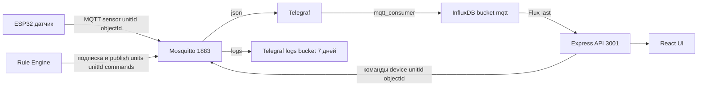

# PROJECT_CONTEXT

## Как пользоваться файлом

- В этом документе — компактная карта монорепозитория САСПИК: назначение, команды, архитектура, инварианты.
- Здесь нет пересказа README и кода; каждый факт сопровождается путём-источником, где его можно проверить.
- Источники истины: код и фактические конфиги (`docker-compose.yml`, `platformio.ini`, `package.json`), затем README/docs.
- Расширенные детали (версии, полные таблицы, протоколы, история решений) — в [`DETAILS.md`](DETAILS.md); в тексте даны ссылки вида → DETAILS#раздел.
- Неподтверждённое помечено `UNKNOWN` или `TODO: проверить`.
- Секреты не раскрываются; упоминаются только имена переменных окружения и дефолты, реально лежащие в конфигах репозитория.

## Что это за проект

- САСПИК — программно-аппаратная платформа для совместного производства: IoT-устройства → MQTT-кластер → веб-UI управления ([`README.md`](README.md:1)).
- Системная иерархия: Кластер (автономный узел сети) → Юнит (функциональная зона: теплица, цех, склад) → Объект (физическое/виртуальное устройство: датчик, контроллер, реле) ([`README.md`](README.md:11)).
- Монорепозиторий из 4 подпроектов:
  - [`saspik-cluster`](saspik-cluster/README.md) — микросервисное ядро на Node.js (API, UI, MQTT-брокер, rule-engine, InfluxDB/Telegraf).
  - [`saspik-iot`](saspik-iot/README.md) — прошивки ESP32 (шлюз ESP-NOW→MQTT, сенсоры, шаблон boilerplate).
  - [`saspik-greenhouse`](saspik-greenhouse/README.md) — пилот «автономная теплица»; сейчас это только планирование/документация.
  - [`saspik-meshrover`](saspik-meshrover/README.md) — рой автономных роботов (Pre-MVP, этап 1: UWB-дальномер).
- Потребители: оператор через веб-UI, устройства через MQTT, другие кластеры (декларировано, реализация кластер-кластер не найдена → UNKNOWN).
- Границы: кластер работает автономно; иерархия и привязка объектов к юнитам настраиваются в БД/UI ([`saspik-cluster/README.md`](saspik-cluster/README.md:7)).

## Быстрый старт

### saspik-cluster (основной стек)

```bash
cd saspik-cluster/saspik-cluster-app
cp example.env .env            # заполнить значения
docker compose up --build -d   # поднимает все 7 сервисов
```

- Сервисы и лимиты ресурсов — в [`docker-compose.yml`](saspik-cluster/saspik-cluster-app/docker-compose.yml:3); зависимости (Node 18, Mongo 7, InfluxDB 2.9.1) — там же.
- Тест-стек без backend/nginx: `docker compose -f docker-compose.test.yml up` ([`docker-compose.test.yml`](saspik-cluster/saspik-cluster-app/docker-compose.test.yml:1)).
- Проверка: `curl http://localhost/health` (nginx → 200) и `curl http://localhost:3001/health` (backend) — healthcheck настроены в compose ([`docker-compose.yml`](saspik-cluster/saspik-cluster-app/docker-compose.yml:47)).

#### Локальная разработка backend

```bash
cd saspik-cluster/saspik-cluster-app/server
npm install
npm run dev            # nodemon + ts-node (загружает .env при NODE_ENV != prod)
npm run build          # tsc → dist/
npm start              # node dist/index.js
npm run lint           # ESLint
```

- Скрипты зафиксированы в [`server/package.json`](saspik-cluster/saspik-cluster-app/server/package.json:8); тестов нет — `npm test` завершается с ошибкой (`echo "no test specified"`).

#### Локальная разработка client

```bash
cd saspik-cluster/saspik-cluster-app/client
npm install
npm start              # CRA dev-server
npm run start:mock     # REACT_APP_MOCK_MODE=true, данные без API
npm run build          # production-сборка
npm test               # Jest (CRA)
```

#### MQTT Rule Engine

```bash
cd saspik-cluster/saspik-cluster-app/mqtt-rule-engine
npm install
npm run dev            # ts-node src/index.ts
npm run build && npm start
npm run test           # тестовый раннер на мок-адаптере
```

- Источник правил выбирается `RULES_SOURCE=mongo|api|file` ([`mqtt-rule-engine/README.md`](saspik-cluster/saspik-cluster-app/mqtt-rule-engine/README.md:35)).

### saspik-iot (прошивки)

- Требуется [PlatformIO Core ≥ 6.x](https://platformio.org) и плата ESP32/S2/S3/C3 ([`esp32-boilerplate/README.md`](saspik-iot/saspik-iot-sketches/esp32-boilerplate/README.md:27)).

```bash
cd saspik-iot/saspik-iot-sketches/esp32-boilerplate
pio run -e sensor_esp32      # сборка шаблона Sensor
pio run -e gateway_esp32 -t upload
pio test -e native           # host-тесты Unity (чистые модули, без железа)
```

- Готовые env: `{gateway,sensor,device}_{esp32,s2,s3,c3}` — в [`platformio.ini`](saspik-iot/saspik-iot-sketches/esp32-boilerplate/platformio.ini:38).
- Действующие скетчи (например `esp32-local-mqtt`): `pio run` / `pio run -t upload` / `pio device monitor` ([`esp32-local-mqtt/README.md`](saspik-iot/saspik-iot-sketches/esp32-local-mqtt/README.md:64)).

### saspik-meshrover

- Проект ESP-IDF (CMake), точка входа [`software/CMakeLists.txt`](saspik-meshrover/software/CMakeLists.txt:1); собирается штатно через `idf.py build` (положение ESP-IDF задаётся `IDF_PATH`).
- Активные команды сборки в репозитории не зафиксированы (нет platformio.ini/Makefile) → UNKNOWN.

## Архитектура и структура

### Поток данных (основной контур)



### Слои saspik-cluster

- `server` — Express + InversifyJS (DI), слои: controllers → services → repositories ([`server/src`](saspik-cluster/saspik-cluster-app/server/src/index.ts:1)).
- `client` — React SPA, компоненты + hooks; API-вызовы напрямую через `fetch` в хуках ([`client/src/hooks/use-objects-list-fetching.ts`](saspik-cluster/saspik-cluster-app/client/src/hooks/use-objects-list-fetching.ts:56)).
- `mqtt-rule-engine` — воркер: адаптер MQTT → движок правил (индекс по топикам) → условия/действия; правила перезагружаются в рантайме ([`mqtt-rule-engine/src/core/engine.ts`](saspik-cluster/saspik-cluster-app/mqtt-rule-engine/src/core/engine.ts:34)).
- `nginx` — статика SPA + прокси `/api` → backend:3001, SPA fallback, кэш статики 1 год ([`nginx/nginx.conf`](saspik-cluster/saspik-cluster-app/nginx/nginx.conf:6)).

### Таблица «путь — назначение — что менять»

| Путь | Назначение | Что менять аккуратно |
| --- | --- | --- |
| [`saspik-cluster/saspik-cluster-app/server/src`](saspik-cluster/saspik-cluster-app/server) | REST API, DI, Mongo/Influx/MQTT | Роуты (`app.ts`), сервисы, репозитории; сборка DI в `index.ts` |
| [`…/server/src/data/units.config.ts`](saspik-cluster/saspik-cluster-app/server/src/data/units.config.ts) + `unitId*.config.ts` | Сиды юнитов/объектов | Только при сознательной миграции Mongo (сид не перезаписывает непустые коллекции) |
| [`…/server/data/rules.json`](saspik-cluster/saspik-cluster-app/server/data/rules.json) | Сид климат-правил (env-подстановка `${VAR}`/`${expr:...}`) | Правила дублируются на unitId — движок не подставляет unitId из wildcard-топика |
| [`…/mqtt-rule-engine/src`](saspik-cluster/saspik-cluster-app/mqtt-rule-engine) | Движок правил | Новые условия/действия: класс + `constants.ts` + `config/builder.ts` |
| [`…/telegraf/telegraf.conf`](saspik-cluster/saspik-cluster-app/telegraf/telegraf.conf:13) | MQTT → InfluxDB | `hostname` и топики подписок — ломают серии/данные при небрежной правке |
| [`…/mqtt/mosquitto.conf`](saspik-cluster/saspik-cluster-app/mqtt/mosquitto.conf:1), `mosquitto.acl` | Брокер, ACL | ACL default-deny: новый топик без правила ACL не пройдёт |
| [`…/influxdb/provision`](saspik-cluster/saspik-cluster-app/influxdb/provision) | Создание бакетов `mqtt`,`logs` при старте | Провижининг нефатален, но без него нет бакета `logs` |
| [`…/client/src`](saspik-cluster/saspik-cluster-app/client/src) | UI | Роуты, формы, hooks; мок-режим через `REACT_APP_MOCK_MODE` |
| [`saspik-iot/saspik-iot-sketches/esp32-boilerplate`](saspik-iot/saspik-iot-sketches/esp32-boilerplate) | Библиотека `saspik-core` + шаблоны ролей | Всё compile-time в `include/config.h`; host-тесты `pio test -e native` |
| [`saspik-iot/saspik-iot-sketches/esp32-local-mqtt`](saspik-iot/saspik-iot-sketches/esp32-local-mqtt) | Действующий сенсор DHT22+LED | `config.h`: топики, таймауты авто-ребута, `USE_MOCK_SENSOR` |
| [`saspik-iot/saspik-iot-sketches/shared`](saspik-iot/saspik-iot-sketches/shared) | Общие библиотеки `wifi-config`, `device-log` | Логика captive portal и NVS-лога причины ребута |
| [`saspik-meshrover/software`](saspik-meshrover/software) | UWB-прошивка (ESP-IDF) | Параметры UWB в `include/config.h`, `lib/dwm3000` |

### Ключевые модули и точки входа

- Backend: [`server/src/index.ts`](saspik-cluster/saspik-cluster-app/server/src/index.ts:94) (bootstrap + DI) → [`server/src/app.ts`](saspik-cluster/saspik-cluster-app/server/src/app.ts:100) (роуты, seed, послестартовые хуки).
- Client: [`client/src/index.tsx`](saspik-cluster/saspik-cluster-app/client/src/index.tsx:7) → [`pages-routes.tsx`](saspik-cluster/saspik-cluster-app/client/src/components/pages-routes/pages-routes.tsx:15).
- Rule engine: [`mqtt-rule-engine/src/index.ts`](saspik-cluster/saspik-cluster-app/mqtt-rule-engine/src/index.ts:16).
- Прошивки: [`esp32-boilerplate/src/main.cpp`](saspik-iot/saspik-iot-sketches/esp32-boilerplate/src/main.cpp) (выбор IApp по `DEVICE_ROLE`); [`esp32-local-mqtt/src/main.cpp`](saspik-iot/saspik-iot-sketches/esp32-local-mqtt/src/main.cpp:64).

### Внешние зависимости и инкапсуляция

- MongoDB — только `server` (драйвер `mongodb`, репозитории в `services/data-store`) и `mqtt-rule-engine` (коллекция `rules`, `MongoRulesProvider`).
- InfluxDB — через Telegraf (запись) и `InfluxDbStateStoreService` (чтение Flux-запросом) ([`influxDbStateStore.service.ts`](saspik-cluster/saspik-cluster-app/server/src/services/state-store/influxDbStateStore.service.ts:39)).
- Rightech API (`MQTT_BROCKER_API_URL`) — задекларировано в [`server/src/const.ts`](saspik-cluster/saspik-cluster-app/server/src/const.ts:35), но `RightechProxyMqttService` биндится на `LocalMqttService` (не реализован) → UNKNOWN.
- MQTT — везде: сервер (`services/mqtt`), rule-engine (`mqtt/adapter.ts`), telegraf-вход, mosquitto.
- ESP-NOW — только прошивки (boilerplate bridge, esp32-controller).

## Стек

| Область | Технологии (из манифестов) |
| --- | --- |
| Backend | Node.js 18 (Dockerfile `node:18-alpine`), TypeScript 5.5, Express 4.19, InversifyJS 6, mongodb 6.10, mqtt 5, @influxdata/influxdb-client 1.35, tslog, class-validator/class-transformer |
| Frontend | React 19.1, CRA 5 (react-scripts), TypeScript 4.9, react-router-dom 6.30, antd icons, bem-react-classname, Jest+RTL |
| Rule Engine | Node ≥18, TypeScript 5.7, mqtt 5.3.5, mongodb 6.10; тесты — самописный `test/test-runner.ts` |
| БД/очереди | MongoDB 7, InfluxDB 2.9.1, Mosquitto 2.0, Telegraf |
| IoT | PlatformIO, Arduino framework (esp32 platform), C++17; ESP-IDF (meshrover); библиотеки PubSubClient, ArduinoJson, DHT, OneWire |
| Деплой | Docker Compose, multi-stage Dockerfile, Nginx; CI отсутствует |
| Линт/формат | ESLint 9 + Prettier (server, rule-engine), .prettierrc (client), CRA-eslint (client) |

- Полные версии зависимостей — в [`server/package.json`](saspik-cluster/saspik-cluster-app/server/package.json:18), [`client/package.json`](saspik-cluster/saspik-cluster-app/client/package.json:8), [`mqtt-rule-engine/package.json`](saspik-cluster/saspik-cluster-app/mqtt-rule-engine/package.json:22) → DETAILS#стек.

## Конфигурация

### saspik-cluster (основные env)

| Переменная | Назначение | Обязат. | Где используется | Дефолт |
| --- | --- | --- | --- | --- |
| `MONGODB_URL` | Строка подключения MongoDB | да | backend, rule-engine | — |
| `INFLUXDB_URL` | URL InfluxDB | да | backend (`influxDbStateStore.service.ts`) | `http://localhost:8086` |
| `INFLUXDB_TOKEN` | Токен InfluxDB | да | backend, telegraf, influxdb | — |
| `INFLUXDB_ORG` | Организация InfluxDB | да | backend, telegraf, influxdb | `saspik` |
| `INFLUXDB_BUCKET` | Основной бакет | да | backend, telegraf, influxdb | `mqtt` |
| `INFLUXDB_LOGS_BUCKET` | Бакет логов | нет | telegraf | `logs` |
| `INFLUXDB_BUCKETS` | Список бакетов для провижининга | нет | influxdb provision | `mqtt,logs` |
| `INFLUXDB_LOGS_RETENTION_DAYS` | Retention логов | нет | influxdb provision | `7` |
| `MQTT_BROKER_URL` | URL брокера | да | backend, rule-engine | compose: `mqtt://mosquitto:1883` |
| `MQTT_USERNAME` / `MQTT_PASSWORD` | Учётка брокера | да | backend, rule-engine, telegraf | compose: `admin`/`password123` |
| `RULES_SOURCE` | Источник правил: mongo/api/file | нет | rule-engine | `mongo` |
| `RULES_API_URL` | URL API правил при RULES_SOURCE=api | усл. | rule-engine | — |
| `RULES_POLL_INTERVAL_MS` | Интервал опроса правил | нет | rule-engine | `5000` |
| `CONFIG_PATH` | Путь rules.json при RULES_SOURCE=file | усл. | rule-engine | `./rules.json` |
| `INIT_RULES_SEED_PATH` | Файл сида правил | нет | backend SeedService | `./data/rules.json` |
| `NODE_ENV` | `prod` — не читать .env, только окружение | нет | ConfigService | — |
| `PORT` | HTTP-порт backend | нет | `app.ts` | `3001` |
| `CLIMATE_CONTROL_UNIT_ID` | Юнит климат-контроля | нет | backend, rule-engine | — |
| `CLIMATE_T_SET/HYST/MAX/MIN/RECOVERY`, `CLIMATE_RH_SET/HYST`, `CLIMATE_NIGHT_*`, `NIGHT_START_HOUR`, `NIGHT_END_HOUR`, `MOSCOW_OFFSET_HOUR`, `WATER_TIMEOUT_MS` | Параметры климат-контроля (гистерезис, ночные профили) | нет | backend, rule-engine (подстановка в правила) | см. [`example.env`](saspik-cluster/saspik-cluster-app/example.env:11) |
| `RIGHTECH_API_TOKEN` | Токен Rightech API | нет | backend | — (фактически не используется → UNKNOWN) |
| `REACT_APP_MOCK_MODE` | Мок-режим UI | нет | client | `false` |

- Полный `.env`-шаблон: [`example.env`](saspik-cluster/saspik-cluster-app/example.env:1).
- Backend читает `.env` только при `NODE_ENV != prod`, путь — `server/../../../.env` ([`config.service.ts`](saspik-cluster/saspik-cluster-app/server/src/config/config.service.ts:18)).
- InfluxDB-инициализация: `DOCKER_INFLUXDB_INIT_*` + `ensure-buckets.sh` ([`influxdb/README.md`](saspik-cluster/saspik-cluster-app/influxdb/README.md:20)).
- Не коммитить: реальные `.env`, содержимое `RIGHTECH_API_TOKEN`/`INFLUXDB_TOKEN`; `mqtt/passwordfile` с реальными паролями (в репо лежит дефолтный).
- Прошивки: Wi-Fi/MQTT-учётка — через captive portal + NVS (`shared/wifi-config`); дефолты — compile-time в `include/config.h`; `env_config.h` генерируется скриптом из `.env` у `esp32-local-mqtt` ([`extra_script.py`](saspik-iot/saspik-iot-sketches/esp32-local-mqtt/extra_script.py)).

## Данные и интерфейсы

### Сущности и связи (MongoDB)

- Коллекции `units`, `objects`, `rules`; объект связан с юнитом полем `unitId`; правила — топиком-триггером и `unitId` (вычисляется из топика при сиде) ([`seed.service.ts`](saspik-cluster/saspik-cluster-app/server/src/data-store/seed.service.ts:92)).
- DTO-схемы: [`shared/types/objects.ts`](saspik-cluster/saspik-cluster-app/shared/types/objects.ts:1), `server/src/dto/*.ts`, JSON Schema — в [`docs/ObjectsService.md`](saspik-cluster/docs/ObjectsService.md:49), [`docs/UnitsService.md`](saspik-cluster/docs/UnitsService.md), [`docs/RulesService.md`](saspik-cluster/docs/RulesService.md).
- Юнит в ответе API агрегирует свои `objects` и `rules` (джойн в памяти, `UnitsService.toUnitDto`) ([`unitsService.service.ts`](saspik-cluster/saspik-cluster-app/server/src/services/units/unitsService.service.ts:125)).

### MQTT (контракт)

- Формат топика: `{домен}/{unitId}/{objectId}[/суффикс]`; источник истины — [`docs/mqtt-topics.md`](saspik-cluster/docs/mqtt-topics.md:7).
- `sensor/{unitId}/{objectId}` — показания (DHT22: `{temperature, humidity}`).
- `device/{unitId}/{objectId}` — команды `{"state":"ON"|"OFF"}` (LED/реле).
- `device/{unitId}/{objectId}/state` — retained-состояние (читает telegraf → UI).
- `device/{unitId}/{objectId}/status` — `{"status":"online|offline"}`, offline — LWT брокера.
- `device/.../log`, `server/worker/log`, `rule-engine/worker/log` — логи в едином JSON-конверте `{level,src,event,msg,topic,unitId,objectId,uptime,cause}` ([`docs/logs.md`](saspik-cluster/docs/logs.md:7)).
- `units/{unitId}/commands/a_relay1..4` — команды климат-контроля (payload `{"state":"1"|"0"}`) — отличается от `ON/OFF` команд объектов (rules.json `_meta`).
- Объекты с постфиксом `-sensor`/`-device`: в топик идёт база без постфикса ([`mqtt-topics.md`](saspik-cluster/docs/mqtt-topics.md:40), [`objectsService.service.ts`](saspik-cluster/saspik-cluster-app/server/src/services/objects/objectsService.service.ts:17)).

### HTTP API (backend)

- Префикс `/api/v1`; Units: `GET /units/list`, `GET /units/:id`, `POST /units`, `PATCH /units/:id`, `DELETE /units/:id` (каскадное удаление объектов).
- Objects: `POST /objects/list/:type`, `POST /objects/getByIds`, `POST /objects/command/:deviceId`, `POST /objects/getLastSensorsData` (заглушка `{}`), `POST /objects`, `PATCH /objects/:id`, `DELETE /objects/:id`.
- Rules: `GET /rules`, `POST /rules`, `PATCH /rules/:id`, `DELETE /rules/:id`.
- Источник истины — [`docs/API.md`](saspik-cluster/docs/API.md:7) и код контроллеров (`server/src/controllers/`); `MqttController` (publish/subscribe) реализован, но **не смонтирован** ([`app.ts`](saspik-cluster/saspik-cluster-app/server/src/app.ts:66)).
- `GET /history/list` не существует — HistoryService только запланирован ([`docs/HistoryService.md`](saspik-cluster/docs/HistoryService.md:5)).
- Формат ошибок: `{error: string}` с HTTP-кодом через `BaseController` ([`baseController.ts`](saspik-cluster/saspik-cluster-app/server/src/common/baseController.ts:20)); нет центральной валидации DTO (есть `validate.middleware.ts`, но не применяется → TODO).

## Ключевые инварианты и ограничения

Формат: «Инвариант — почему — где поддерживается».

1. Топик объекта = `{type}/{unitId}/{baseId}` без постфикса — иначе потеряются данные/команды — `ObjectsService.createObject/updateObject`, docs/mqtt-topics.
2. `updateObject` пересчитывает topic только для канонических топиков (`sensor|device/{unitId}/...`); произвольные seed-топики (`led/control`) сохраняются — правка через UI не рвёт подписки — [`objectsService.service.ts`](saspik-cluster/saspik-cluster-app/server/src/services/objects/objectsService.service.ts:177).
3. Сиды идемпотентны: пишут только в пустые коллекции — ручное изменение сида не обновит существующие данные — [`seed.service.ts`](saspik-cluster/saspik-cluster-app/server/src/services/data-store/seed.service.ts:29).
4. Правило с `enabled:false` движок пропускает и не подписывается на его топики; сид всегда добавляет `enabled:true` — [`mqtt-rule-engine/README.md`](saspik-cluster/saspik-cluster-app/mqtt-rule-engine/README.md:59), [`seed.service.ts`](saspik-cluster/saspik-cluster-app/server/src/services/data-store/seed.service.ts:87).
5. Telegraf: `[agent] hostname = "telegraf"` — стабильная серия в Influx; смена host плодит серии и ломает `last()` в UI (исторический инцидент 2026-09-20) — [`telegraf.conf`](saspik-cluster/saspik-cluster-app/telegraf/telegraf.conf:13), `IN_PROGRESS.md`.
6. Telegraf-JSON-вход: топик с не-JSON payload роняет весь батч `mqtt_consumer`; поэтому `healthcheck/ping` — валидный JSON и `healthcheck/#` исключён из входов — [`mqtt-topics.md`](saspik-cluster/docs/mqtt-topics.md:101).
7. Mosquitto ACL default-deny: новый домен топиков требует записи в `mosquitto.acl` и публикации `passwordfile` — [`mqtt/README.md`](saspik-cluster/saspik-cluster-app/mqtt/README.md:37).
8. Retained `device/.../state` — единственный источник актуального состояния устройства для UI; потеря retain-поля ломает статусы — [`mqtt-topics.md`](saspik-cluster/docs/mqtt-topics.md:84), `objectsService.subscribeDeviceStatus`.
9. Климат-правила дублируются на каждый `unitId`; движок не умеет подставлять unitId из wildcard-топика — `_meta/@todo` в [`rules.json`](saspik-cluster/saspik-cluster-app/server/data/rules.json:20).
10. ESP32: MQTT-connect должен быть неблокирующим (таймауты + `yield()`), иначе Task WDT → `rst:0x8`; `upload_speed=115200` (CP2102) — [`esp32-local-mqtt/IN_PROGRESS.md`](saspik-iot/IN_PROGRESS.md:52).
11. Device (ESP32): публикует только события (startup/reboot/connect/reconnect/diag), не каждое чтение датчика — анти-спам в Influx — [`docs/logs.md`](saspik-cluster/docs/logs.md:58).
12. ESP-NOW v2 (boilerplate) несовместим с v1 (node-sensor-1): другой формат кадра и CRC-8/MAXIM; миграция узлов — отдельная задача — [`esp32-boilerplate/README.md`](saspik-iot/saspik-iot-sketches/esp32-boilerplate/README.md:130).

## Соглашения разработки

- Нейминг устройств: шифр `saspik-{роли}{протокол}{питание}{nnn}`; шаблон — `nnn=000`; реестр занятых id — [`saspik-iot/devices.md`](saspik-iot/devices.md:1) (намеренно вне `docs/`, чтобы не краулился docs-gen).
- Заголовки README подпроектов: `# ⧫ Название` + строка описания; ссылка `[↑ Назад](../README.md)`.
- Файлы «хода работ» `IN_PROGRESS.md` — датированные блоки решений/инцидентов (новые сверху) — фактически журнал ADR (README подпроектов + IN_PROGRESS.md).
- Backend: DI-контейнер в [`server/src/index.ts`](saspik-cluster/saspik-cluster-app/server/src/index.ts:39), TYPES в `types.ts`, интерфейс + реализация на каждый сервис/контроллер.
- Обработка ошибок в REST: try/catch в контроллере, `{error}` + код; глобальный `ExeptionFilter` — зарегистрирован в [`app.ts`](saspik-cluster/saspik-cluster-app/server/src/app.ts:80).
- Логирование: единый JSON-конверт `{level,src,event,msg,...}` во всех компонентах кластера ([`docs/logs.md`](saspik-cluster/docs/logs.md:7)).
- Коммиты без единого стандарта (формат не зафиксирован); в IN_PROGRESS упоминаются короткие хеши коммитов.
- Тесты: только там, где есть — client (Jest/RTL), rule-engine (test-runner), boilerplate (Unity host-тесты); требований к покрытию нет.
- `docs.html` в корне — агрегированная HTML-версия docs (генерация скриптом docs-gen, детали → UNKNOWN).

## Типовые задачи

| Задача | Куда смотреть | Что учесть |
| --- | --- | --- |
| Добавить эндпоинт API | `server/src/controllers/` + `const.ts` + DI в `index.ts` | Роуты монтируются в `app.ts`; не забыть `ControllersDomens` |
| Добавить объект/юнит в UI | `client/src/components/unit-form|object-form`, хуки, `mock-data.ts` | В мок-режиме данные свои; `REACT_APP_MOCK_MODE` |
| Разрешить новый MQTT-домен | `mqtt/mosquitto.acl` + `telegraf/telegraf.conf` + docs/mqtt-topics | ACL default-deny; JSON-парсинг в telegraf |
| Добавить правило климат-контроля | `server/data/rules.json` (сид) и/или `rules`-коллекция Mongo | Дублировать на unitId; `${VAR}`/`${expr:...}` подстановка |
| Новый тип условия/действия в rule-engine | `mqtt-rule-engine/src/conditions|actions` + `constants.ts` + `config/builder.ts` | Тест в `test/test-runner.ts` на мок-адаптере |
| Новая прошивка ESP32 | Копия `esp32-boilerplate` или скетч по шаблону | Зарегистрировать objectId в `devices.md`; классификатор; топики в mqtt-topics.md |
| Правка существующего объекта через UI | `objectsService.updateObject` | Канонический topic пересчитается, seed-топик останется (инвариант 2) |
| Миграция Mongo | Прямые команды в Mongo; `SeedService` не перезапишет | Зависит от доступности docker (см. IN_PROGRESS 2026-10-20) |
| Разобраться с показаниями в Influx/UI | Flux в `influxDbStateStore.service.ts`, `telegraf.conf`, бакеты | Проверять `hostname`, серии, `group()` перед `last()` |
| Отладка device-логов | `docs/logs.md`, бакет `logs`, `influxdb/queries/logs-view.flux` | `_time` — граница окна агрегации, не точное время события |
| Сборка/прошивка устройства | `platformio.ini` соответствующего скетча | `115200` upload; partitions 4MB «spiffs» |

## Тестирование

- **Backend**: тестов нет (`npm test` → error) → TODO: проверить планы по Jest/supertest ([`server/package.json`](saspik-cluster/saspik-cluster-app/server/package.json:15)).
- **Client**: Jest + Testing Library (CRA): `App.test.tsx`, `mock-data.test.ts`; запуск — `npm test` ([`client/package.json`](saspik-cluster/saspik-cluster-app/client/package.json:31)).
- **Rule Engine**: самописный раннер `npm run test` — `test/test-runner.ts` + `mock-mqtt-adapter.ts` + `sample-rules.json` (мок-адаптер, без брокера) ([`mqtt-rule-engine`](saspik-cluster/saspik-cluster-app/mqtt-rule-engine/test/test-runner.ts)).
- **Прошивки**: host-тесты Unity чистой логики (`pio test -e native`): TopicBuilder, EspNowCodec (CRC-8 known-answer), bridge, ConfigManager, TimerRegistry; моки — `test/mocks/` ([`esp32-boilerplate/README.md`](saspik-iot/saspik-iot-sketches/esp32-boilerplate/README.md:111)).
- **Integration-заглушка**: `docker-compose.test.yml` (mosquitto+influxdb+telegraf) для ручной проверки конвейера MQTT→InfluxDB.
- Известные слабости: нет end-to-end тестов сервера с Mongo/Influx; фикстур для Influx-запросов нет; мок DHT22 в прошивке (`USE_MOCK_SENSOR=true`) — актуален физически.

## Деплой и эксплуатация

- Деплой: `docker compose build && docker compose up -d` из `saspik-cluster-app`; nginx отдаёт SPA и проксирует `/api`.
- Healthcheck'и: backend `/health` (wget), nginx `/health`, mongo `mongosh ping`, mosquitto `mosquitto_pub` в `healthcheck/ping` ([`docker-compose.yml`](saspik-cluster/saspik-cluster-app/docker-compose.yml:47)).
- Данные: volume `mongo-data`, `influxdb-data`; миграции БД — ручные (инструмент миграций отсутствует).
- Логи: `docker compose logs -f <service>`; агрегация логов — MQTT → telegraf → InfluxDB бакет `logs` (retention 7 дней).
- Метрики: отдельного метрик-стека нет (только данные/логи в InfluxDB) → UNKNOWN планов.
- Откат: пересборка предыдущего образа compose; данные сохраняются в volumes; правило -> откат состояния реле — retained `.../state`.
- Прод-инфраструктура (вне docker-compose): брокер `185.72.145.19:1883` упомянут в [`mqtt-topics.md`](saspik-cluster/docs/mqtt-topics.md:109) — актуальность и способ управления → UNKNOWN.

## Риски

- Нет CI и автотестов на backend — регрессии ловятся вручную.
- `npm test` backend не реализован; `getLastSensorsData` и `HistoryService` — заглушки/план.
- Рассинхрон прошивки и конфигов: `esp32-local-mqtt` в `config.h` — `m003/unitId3`, в README/IN_PROGRESS — `m002/unitId2` → TODO: проверить эталон.
- Rightech-интеграция не реализована фактически (`RightechProxyMqttService` → `LocalMqttService`), константа и env остались.
- `ClimateControlService` в server отключён (закомментирован в `app.ts:92`), но `CLIMATE_*` env используются rule-engine-правилами — дублирование логики в двух местах рискует рассинхроном.
- Креды mosquitto/InfluxDB по умолчанию лежат в compose (`admin123` и т.п.) — нельзя выносить в прод без смены.
- Правила климат-контроля размножены на unitId (нет шаблонизации по топику) — правки рискованны.
- ESP-NOW v1/v2 несовместимы: смешение узлов в одной сети сломает парсинг.
- Файлы `.env` и `passwordfile` с реальными кредами — риск утечки (в `.codeassistantignore` **/.env).

## Решения и компромиссы

| Решение | Причина | Альтернативы | Последствия |
| --- | --- | --- | --- |
| MQTT + Telegraf + InfluxDB вместо записи в БД от backend | Масштабирование данных датчиков, единый конвейер логов | Прямая запись в Mongo/Postgres | Устройства не знают о БД; появился нефатальный провижининг бакетов |
| MongoDB для конфигурации (units/objects/rules), InfluxDB для временных рядов | Разные модели данных | Только time-series / только документы | Джойн юнитов в памяти сервера |
| Rule-engine как отдельный воркер с опросом правил | Правила меняются без рестарта, источники mongo/api/file | Правила внутри backend | Дублирование климат-логики с отключённым ClimateControlService |
| `hostname = "telegraf"` фиксирован | Стабильные серии Influx после инцидента «статики» 2026-09-20 | Динамический host | Все логи/данные в одной серии host |
| `updateObject` не трогает неканонический topic | Сохранение seed-топиков (`led/control`, произвольные) | Пересчёт всегда | Два правила формирования топика |
| ESP-NOW v2 с CRC-8/MAXIM и типами кадров | Единый протокол для новых узлов | Совместимость с v1 | Разрыв с node-sensor-1 |
| ESP32: неблокирующий MQTT-connect + авто-ребут | WDT-ресеты (rst:0x8) при недоступном брокере | Блокирующий connect | Устройства переживают обрывы, но есть случай «мёртвых веток логов» (guard на `connected()`) |
| Siды только в пустые коллекции | Предсказуемый первичный старт | Upsert всегда | Изменение сида не мигрирует прод-данные |
| `healthcheck/ping` — валидный JSON | Падал батч telegraf при не-JSON payload | Исключение топика из telegraf | Обе меры применены |

- Формальных ADR нет; роль журнала решений играют `IN_PROGRESS.md` в каждом подпроекте (история инцидентов и планов) → DETAILS#история.

## Глоссарий

- **Кластер** — автономный узел сети САСПИК (этот docker-стек).
- **Юнит (Unit)** — функциональная зона кластера (теплица, цех).
- **Объект (Object)** — устройство/канал (sensor | device); сущность Mongo, имеет `topic` и `spec[]`.
- **spec** — массив каналов объекта: `{key, model, unit, minorPart}`.
- **Правило (Rule)** — запись rule-engine: `{trigger, when, then, enabled}`.
- **State Store** — чтение последних значений из InfluxDB (`IStateStoreService`).
- **Retained/`state`/`status`** — retained-топики состояния и online/offline-статуса устройства.
- **LWT** — Last Will (offline при обрыве соединения).
- **Конверт лога** — единый JSON `{level,src,event,msg,...}` для device/server/rule-engine.
- **Скетч** — проект PlatformIO (прошивка ESP32).
- **saspik-core** — SOLID-библиотека boilerplate (config/log/mqtt/espnow/...).
- **TWR** — Two-Way Ranging (UWB, meshrover).
- **САСПИК / ATSAP** — проект переименован atsap → saspik (IN_PROGRESS 2026-09-20).

## Карта для дальнейшего изучения

- Корень: [`README.md`](README.md:1), [`docs.html`](docs.html) (агрегированные docs), [`index.html`](index.html) (лендинг).
- Кластер: [`saspik-cluster/README.md`](saspik-cluster/README.md:1), [`saspik-cluster-app/README.md`](saspik-cluster/saspik-cluster-app/README.md:1) у каждого сервиса, docs: [`API.md`](saspik-cluster/docs/API.md), [`mqtt-topics.md`](saspik-cluster/docs/mqtt-topics.md), [`logs.md`](saspik-cluster/docs/logs.md), [`ObjectsService.md`](saspik-cluster/docs/ObjectsService.md), [`UnitsService.md`](saspik-cluster/docs/UnitsService.md), [`RulesService.md`](saspik-cluster/docs/RulesService.md), [`HistoryService.md`](saspik-cluster/docs/HistoryService.md).
- Журнал решений/инцидентов: [`saspik-cluster/IN_PROGRESS.md`](saspik-cluster/IN_PROGRESS.md:1), [`saspik-iot/IN_PROGRESS.md`](saspik-iot/IN_PROGRESS.md:1), [`saspik-greenhouse/IN_PROGRESS.md`](saspik-greenhouse/IN_PROGRESS.md:1).
- IoT: [`saspik-iot/README.md`](saspik-iot/README.md:1), [`saspik-iot/devices.md`](saspik-iot/devices.md:1), [`docs/classification.md`](saspik-iot/docs/classification.md:1), [`docs/boilerplate-architecture.md`](saspik-iot/docs/boilerplate-architecture.md), [`esp32-boilerplate/README.md`](saspik-iot/saspik-iot-sketches/esp32-boilerplate/README.md:1).
- Точки входа для понимания кода: [`server/src/app.ts`](saspik-cluster/saspik-cluster-app/server/src/app.ts:100), [`server/src/index.ts`](saspik-cluster/saspik-cluster-app/server/src/index.ts:94), [`mqtt-rule-engine/src/core/engine.ts`](saspik-cluster/saspik-cluster-app/mqtt-rule-engine/src/core/engine.ts:12), [`esp32-boilerplate/src/app`](saspik-iot/saspik-iot-sketches/esp32-boilerplate/src/app).
- Конфиги-якоря: [`docker-compose.yml`](saspik-cluster/saspik-cluster-app/docker-compose.yml:1), [`telegraf.conf`](saspik-cluster/saspik-cluster-app/telegraf/telegraf.conf:1), [`example.env`](saspik-cluster/saspik-cluster-app/example.env:1), [`mosquitto.acl`](saspik-cluster/saspik-cluster-app/mqtt/mosquitto.acl).
- MeshRover: [`saspik-meshrover/README.md`](saspik-meshrover/README.md:1), [`docs/hardware.md`](saspik-meshrover/docs/hardware.md), [`software/lib/dwm3000`](saspik-meshrover/software/lib/dwm3000).
- Greenhouse: [`saspik-greenhouse/docs/grow_chamber.md`](saspik-greenhouse/docs/grow_chamber.md), [`docs/sensor-ph-ec.md`](saspik-greenhouse/docs/sensor-ph-ec.md), [`docs/smeta.md`](saspik-greenhouse/docs/smeta.md).

## Открытые вопросы

- Актуальный эталон `esp32-local-mqtt`: `config.h` = `saspik.sa.wm.m003/unitId3`, README/IN_PROGRESS = `m002/unitId2` → TODO: проверить, что истина.
- Rightech API (`RIGHTECH_API_TOKEN`, `MQTT_BROCKER_API_URL`) — мёртвый код или планируется к использованию?
- Кто отвечает за климат-контроль фактически: rule-engine-правила (env-подстановка) или серверный `ClimateControlService` (сейчас отключён)?
- Статус прод-деплоя: брокер `185.72.145.19`, способ управления (Portainer?), процедура миграций Mongo → UNKNOWN.
- Реализация кластер-кластер взаимодействия (декларировано в корневом README, кода нет) → UNKNOWN.
- `docs.html` — генерация скриптом docs-gen: где живёт генератор → UNKNOWN.
- Файл `_temp.md` в корне — служебный/мусор → проверить.

## SELF-CHECK

- Оценочный размер: ~6–7 тыс. токенов (PROJECT_CONTEXT.md).
- Что опущено: полные листинги правил климат-контроля, все метрики DTO, детальные таблицы версий, полные тексты IN_PROGRESS — вынесены в `DETAILS.md`.
- Оставшиеся UNKNOWN/TODO: эталон m002/m003; Rightech; фактический владелец климат-контроля; прод-деплой; CI; генератор docs.html; статус `getLastSensorsData`; `_temp.md`.
- 3 вопроса владельцу:
  1. Какой objectId/unitId является эталоном для действующего сенсора `esp32-local-mqtt` — `m002/unitId2` или `m003/unitId3`, и есть ли живое устройство на каждом?
  2. Климат-контроль сейчас фактически выполняет rule-engine (правила из `rules.json` с `CLIMATE_*`), а серверный `ClimateControlService` остаётся отключённым навсегда или планируется включение и нужно убрать дублирование?
  3. Есть ли рабочий прод-кластер (адрес `185.72.145.19`) и утверждённая процедура деплоя/миграции Mongo, или текущий docker-compose — единственная среда?